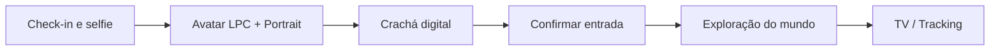
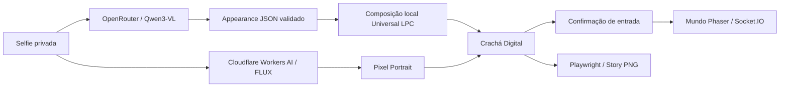

# Mundo // Digital

Uma experiência phygital: sua selfie vira um personagem em um mundo digital vivo.


**Selfie → Avatar → Crachá → Mundo.** Um projeto pessoal e experimental de Lucas Garofolo, conectando pixel art, IA e presença digital em uma experiência coletiva na TV.

<!-- HERO IMAGE
Substitua por uma captura ampla do mapa com vários avatares circulando.
Quando docs/images/hero.png existir, ative:

-->

[Como funciona](#como-funciona) · [Arquitetura](#arquitetura) · [Rodando localmente](#rodando-localmente) · [Galeria](#galeria)

## O que é o Mundo // Digital?

O visitante faz check-in pelo celular e tira uma selfie. Uma IA analisa características visuais, que são transformadas em um avatar **Universal LPC** por composição local. Em paralelo, outro pipeline gera um **portrait pixel art**. As duas representações se encontram no crachá digital.

Ao confirmar a entrada no crachá, o participante vê seu personagem chegar à Sala de Acesso e explorar um mundo isométrico em **Phaser 3**. Ele circula entre áreas, visita pontos de interesse e participa de pequenas interações visuais. A exploração é automática, sem controle do personagem pelo celular.

Na TV, operadores podem localizar participantes pelo nome e acompanhar seus avatares. Depois da entrada, o crachá pode ser baixado e compartilhado como **Story PNG de 1080 × 1920**, quando a exportação estiver pronta.

## Como funciona



### Check-in

Captura e revisão da selfie, com aviso obrigatório sobre o processamento por IA.

<!-- Adicionar docs/images/checkin.png: tela de captura/aviso de selfie.

-->

### Crachá Digital

Portrait, avatar LPC e número do passe reunidos na credencial de entrada.

<!-- Adicionar docs/images/pass.png: portrait + LPC + número do passe.
O QR Code para check-in existe na TV, não no crachá atual.

-->

### Mundo

Cinco blocos conectados, personagens circulando e câmera com busca e acompanhamento. O QR Code da TV leva ao check-in.

<!-- Adicionar docs/images/world.png: mapa com participantes circulando.

-->

## Destaques

- **Da selfie a duas identidades visuais:** sprite LPC animado e portrait pixel art.
- **Mundo em tempo real:** simulação compartilhada, Phaser e Socket.IO.
- **POIs com comportamento:** posições reservadas, emotes, demos de máquinas e encontros ocasionais.
- **Operação integrada:** tracking, controle remoto da TV e painel administrativo autenticado.
- **Crachá compartilhável:** exportação em Story sem nova chamada à IA para regenerar o arquivo.
- **Selfie temporária:** armazenamento privado e limpeza automática após encerrar seu uso.

## Arquitetura

Dois pipelines independentes trabalham sobre a selfie. Este é o fluxo com OpenRouter para análise e Cloudflare como provedor padrão de portrait:



**Pipeline A — avatar:** a IA classifica atributos visuais; o backend valida o JSON e monta as camadas LPC. OpenRouter não desenha o sprite. `AVATAR_PROVIDER` também aceita `local` (avatar padrão sem análise), `ollama` e `gemini`. Falhas usam o fallback LPC existente; “Gerar outra versão” é uma variação local.

**Pipeline B — portrait:** Cloudflare Workers AI é o padrão. Também é possível selecionar OpenRouter e habilitar fallback entre os provedores, desativado por padrão. Essa escolha não altera o pipeline LPC. Uma falha no portrait não invalida necessariamente o crachá.

SQLite persiste participantes, estado do mundo e sessões. Os assets ficam em `DATA_DIR`. O Story usa HTML/CSS e Playwright, reaproveitando LPC e portrait existentes.

[Pipeline de avatar](docs/avatar-pipeline.md) · [Portrait e Story](docs/portrait-pass.md) · [Credencial e entrada](docs/credential-flow.md)

<!-- Opcional: substitua por um diagrama visual da arquitetura.

-->

## Um mundo que parece vivo

Cada ponto de interesse tem capacidade, permanência variável e **visitor slots**: posições reservadas para observar uma máquina, bancada ou exposição. Os avatares seguem caminhos e portais, alternam destinos e mantêm uma memória curta das visitas recentes.

O **facing** orienta o personagem para o que ele observa. Olhares, emotes e microinterações dão ritmo às paradas. Pequenos grupos surgem pela ocupação dos slots, com acenos e reações compartilhadas ocasionais.

**Não há IA generativa decidindo cada movimento.** O comportamento é local, leve e baseado em regras e probabilidades: o backend coordena a simulação, e o frontend apresenta os efeitos. Não há diálogos gerados nem relações sociais persistentes.

O mapa é uma interpretação estilizada, não uma reprodução CAD. A navegação usa um grafo; não há desvio físico avançado entre participantes, e sobreposições podem ocorrer.

[POIs](docs/poi-visits.md) · [Comportamentos visuais](docs/visit-visual-behavior.md) · [Interações sociais](docs/social-behavior.md) · [Tracking](docs/operator-tracking.md)

<!-- GIF recomendado: 6–12 segundos mostrando avatares andando, parando em POIs e interagindo.

-->

## Privacidade da selfie

O check-in exige ciência do processamento por IA. A selfie fica privada e temporária no servidor e, no fluxo com provedores externos, é enviada aos serviços necessários para analisar a aparência e gerar o portrait.

A exclusão automática ocorre quando os dois pipelines encerram seu uso, incluindo tentativas pendentes e consumidores ainda ativos. Falhas de exclusão são registradas e podem ser repetidas; a limpeza também é retomada após reinicialização.

Entre as imagens, permanecem os **assets derivados**: LPC, portrait e Story. Dados cadastrais e operacionais continuam no banco. Provedores externos seguem suas próprias políticas de processamento e retenção.

[Detalhes do ciclo de vida da selfie](docs/selfie-privacy.md)

## Tecnologias

| Categoria | Stack |
| --- | --- |
| **Backend** | Node.js 24+, Express 5, SQLite, Socket.IO e Sharp |
| **Frontend / Mundo** | Phaser 3.90, HTML, CSS e JavaScript com ES modules |
| **IA — análise** | OpenRouter / `qwen/qwen3-vl-30b-a3b-instruct`; alternativas Gemini e Ollama |
| **IA — portrait** | Cloudflare Workers AI / `@cf/black-forest-labs/flux-2-klein-4b` por padrão, com suporte a 9B; alternativa OpenRouter / `black-forest-labs/flux-3-image-klein` |
| **Avatares** | Universal LPC e composição local |
| **Infra e ferramentas** | Railway, GitHub, Playwright / Chrome ou Chromium para Story e testes |

Não há build de frontend. Phaser e sprites são servidos localmente; os serviços externos de IA precisam de conexão e credenciais.

## Por que Universal LPC?

Sprites modulares permitem combinar cabelo, roupas e acessórios a partir de um catálogo consistente. A composição acontece localmente, com animações direcionais no Phaser, sem depender da geração de imagem por IA para o avatar do mundo.

[Catálogo e integração](docs/lpc-avatar-options.md) · [Créditos e licenças dos assets](CREDITS-LPC.md)

As camadas utilizadas têm licença **OGA-BY 3.0** documentada. Essa licença dos assets não define uma licença para o código do projeto.

## Estrutura do mundo

| Bloco | Alguns ambientes / POIs |
| --- | --- |
| **A · Superior** | Praça Cívica, Braço Robótico, Impressão 3D e Corte a Laser |
| **B · Superior** | Sala de Acesso, Culinária, Ar-Condicionado e Corte e Costura |
| **B · Inferior** | Pneumática, Hidráulica, Metrologia e Manutenção Mecânica |
| **C · Superior** | Elétrica e Solda |
| **C · Inferior** | Tornearia, CNC, Injetora Plástica e Ponte Rolante |

Passagens e escadas conectam os blocos. A configuração macro está em `public/js/macroWorldConfig.js`; a Sala de Acesso mantém sua definição em `public/js/world-config.js`. [Detalhes do mundo](docs/macro-world.md).

<!-- Capturas opcionais por bloco. Ative somente após adicionar os arquivos.


-->

## Rodando localmente

Requer **Node.js 24+**; `.node-version` fixa **24.13.0**.

```sh
git clone https://github.com/lucasgarofolo/mundodigital.git
cd mundodigital
npm ci
```

Crie o `.env` na raiz seguindo as [variáveis documentadas](docs/production.md#variáveis-necessárias), adaptadas ao ambiente local. O `.env.example` citado nos documentos não está presente nesta cópia do projeto.

Configure `SESSION_SECRET` com pelo menos 32 bytes aleatórios, `APP_ORIGIN` com a origem local e as credenciais dos provedores escolhidos. Para o fluxo apresentado aqui, use `AVATAR_PROVIDER=openrouter`. O modo `local` dispensa a análise visual por IA, mas não desativa automaticamente o pipeline de portrait.

```sh
npm run admin:create
npm start
```

O CLI solicita usuário e senha interativamente. Abra o [check-in](http://localhost:3000/check-in) ou faça [login](http://localhost:3000/login) para acessar [mundo / TV](http://localhost:3000/world), [admin](http://localhost:3000/admin) e [operador](http://localhost:3000/operator). A porta padrão é 3000, configurável por `PORT`.

Para Story, o padrão local usa Chrome instalado. Para Chromium, execute `npx playwright install chromium` e configure `STORY_BROWSER_CHANNEL=chromium`. O pacote npm sozinho não instala o navegador.

No PowerShell com scripts bloqueados, use `npm.cmd` e `npx.cmd`. `npm start` inclui `--use-system-ca`, mantendo a validação TLS. Na TV, F11 ativa tela cheia; a câmera oferece zoom, reset e tracking.

### Variáveis importantes

```text
OPENROUTER_API_KEY
CLOUDFLARE_API_TOKEN
CLOUDFLARE_ACCOUNT_ID
SESSION_SECRET
DATA_DIR
APP_ORIGIN
AVATAR_PROVIDER
PORTRAIT_PROVIDER
OPENROUTER_PORTRAIT_API_KEY
```

Modelos, timeouts, certificados e demais configurações: [produção](docs/production.md) e [portrait](docs/portrait-pass.md). Não versione o `.env`.

### Demonstração e testes

```sh
npm run demo:world -- 100
npm test
npm run test:browser
```

A demonstração cria 100 participantes fictícios e 12 variações LPC em banco isolado, sem chamadas de IA. Abra `http://127.0.0.1:3001/tela?block=blockA_upper` e use **Explorar**. Configure `SESSION_SECRET` e crie uma conta no `DATA_DIR` isolado informado pelo script. Ctrl+C encerra a instância; uma porta alternativa pode ser passada como segundo argumento.

Os testes cobrem check-in, autenticação, pipelines, persistência, privacidade, mundo e operação. Testes de navegador e exportação Story exigem navegador instalado. `npm run avatar:build` recompõe o avatar LPC offline.

## Segurança

Check-in e passe são públicos. Mapa/TV, admin, operação, tracking e câmera exigem autenticação no backend, inclusive via Socket.IO. Operações individuais do cadastro usam o token do próprio participante.

Segredos ficam em variáveis de ambiente, sessões ficam no backend em SQLite e senhas administrativas usam Argon2id. Selfies não têm rota pública. `DATA_DIR` fica fora de `public`, e o passe não expõe e-mail, selfie ou caminhos privados.

[Autenticação e rotas](docs/authentication.md) · [Operações administrativas](docs/admin-operations.md)

## Deploy

A aplicação exige **um processo Node em uma única instância**, volume persistente para `DATA_DIR`, SQLite e assets gerados. O host precisa de Chromium/Playwright e suas bibliotecas para exportar Story.

Configure HTTPS, `APP_ORIGIN`, `SESSION_SECRET` e `TRUST_PROXY` conforme o proxy real, com suporte a WebSocket. O healthcheck público é `/health`.

O ambiente registrado no projeto é Railway: [check-in público](https://mundodigital-production.up.railway.app/check-in). A disponibilidade e a publicação das alterações locais não foram revalidadas nesta revisão documental.

**[Guia completo de produção](docs/production.md)**

## Galeria

Os espaços de mídia estão comentados para evitar links quebrados. Adicione capturas reais e ative as referências seguindo o [guia de imagens](docs/images/README.md).

<!-- Ative a galeria quando os três arquivos existirem.
Sugestões: check-in, crachá, mapa, tracking, admin com dados de demonstração,
avatar LPC e portrait. Escolha três recortes complementares e ajuste os textos alt.
<p align="center">
  
  
  
</p>
-->

## Roadmap

Implementado no código, sem presumir que toda alteração local esteja publicada:

- [x] Check-in com selfie e ciência do processamento por IA.
- [x] Avatar LPC, pixel portrait e crachá com exportação Story.
- [x] Mundo Phaser com cinco blocos e entrada confirmada.
- [x] POIs, comportamentos visuais e encontros sociais ocasionais.
- [x] Tracking, operação remota e administração autenticada.
- [x] Persistência e exclusão automática da selfie após seu uso.
- [ ] Adicionar screenshots e GIFs reais ao repositório.

## Por que eu fiz isso?

Criei o Mundo // Digital como um experimento para explorar a fronteira entre espaço físico, identidade digital, pixel art e IA generativa. A proposta é transformar uma selfie em presença dentro de um ambiente compartilhado.

**Projeto pessoal e experimental, sem vínculo institucional.**

## Autor

**Lucas Garofolo**

[GitHub](https://github.com/lucasgarofolo) · [LinkedIn](https://www.linkedin.com/in/lucas-garofolo-94b8bb6a)
