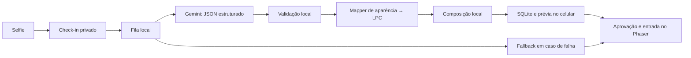

# Avatar pipeline — Fase 4.1

> Atualiza??o de privacidade: a selfie privada agora ? tempor?ria e ? apagada ap?s ambos os consumidores encerrarem. Consulte a [pol?tica atual](selfie-privacy.md). Assets gerados e metadados permanecem; descri??es de reten??o permanente abaixo s?o hist?ricas.

Atualizado pela [Fase 4.2](avatar-experience.md): o check-in salva o participante e a foto privada, mas o avatar só entra no mundo após a prévia, a aprovação e o atraso configurado. A personalização continua em background; uma falha da IA produz uma prévia padrão que também precisa de aprovação. Sala 5, câmera, navegação, UUID e sprites existentes foram preservados. O modo `/tela?lpcTest=true` continua disponível.



## Configurar e testar com sua selfie

Requer Node.js 24+. `@google/genai` é a única dependência nova. Sharp e o suporte nativo do Node a `.env` foram reaproveitados; não foi necessário dotenv.

1. Copie `.env.example` para `.env` e edite esse arquivo **localmente**:

   ```dotenv
   AVATAR_PROVIDER=gemini
   GEMINI_API_KEY=sua_chave_aqui
   GEMINI_MODEL=gemini-3.5-flash-lite
   ```

2. Execute `npm.cmd start`. Se o servidor estiver aberto, encerre-o e inicie novamente para carregar as variáveis.
3. Abra `http://localhost:3000/tela` em uma janela e `http://localhost:3000/check-in` em outra. Use sua selfie autorizada e um **e-mail novo**. Um e-mail já cadastrado reutiliza o participante e não dispara análise.
4. Aguarde a prévia animada no celular. Confira a aparência e pressione **ENTRAR NO MUNDO // DIGITAL**. Após o atraso padrão de 8 segundos, o avatar entra pela porta no telão.
5. Recarregue o celular ou o telão e reinicie o servidor: a aprovação, o horário de entrada e o avatar são recuperados do banco, sem nova análise.

`GEMINI_MODEL` é centralizado em `geminiConfig()` e pode ser trocado por outro modelo com suporte a imagem e JSON Schema. O padrão está em um único lugar. Consulte os [modelos oficiais](https://ai.google.dev/gemini-api/docs/models) e a [referência de configuração do SDK](https://googleapis.github.io/js-genai/release_docs/interfaces/types.GenerateContentConfig.html).

Com `AVATAR_PROVIDER=local` o evento funciona completamente offline com LPC default. Com `gemini` e chave ausente/inválida, o check-in continua funcionando e a análise termina em `FALLBACK`. A chave não é exposta pela API, frontend, banco, eventos ou logs. `.env`, variantes `.env.*`, `data` e `.test-data` são ignorados; `.env.example` contém somente campos de exemplo.

## Serviço, privacidade e validação

No formulário, **Tirar selfie** abre a câmera com `getUserMedia`, preferência pela câmera frontal e sem áudio. Use **Fotografar** para capturar um JPEG de até 1024 pixels no maior lado ou **Cancelar** para sair. A câmera é desligada após captura, cancelamento, troca para arquivo ou saída da página. **Escolher foto** continua separado. O navegador exige permissão e HTTPS ou localhost para acessar a câmera; em HTTP por IP da rede, a interface explica a necessidade de conexão segura em vez de abrir arquivos automaticamente. Consulte [getUserMedia](https://developer.mozilla.org/en-US/docs/Web/API/MediaDevices/getUserMedia).

Somente `lib/geminiAvatarAnalyzer.js` chama a API. Sua interface é `analyzeSelfie(imagePath)`; o segundo argumento opcional contém apenas um AbortSignal. A foto é orientada por EXIF, reduzida a no máximo **768×768**, sem upscale e preservando proporção, e convertida em JPEG de qualidade 82 sem metadados. O upload privado já é normalizado a no máximo 1024×1024. A versão de análise fica em memória e seus buffers são limpos após uso.

Gemini recebe **imagem + instrução visual + catálogo/schema**, sem nome, e-mail, UUID ou instituição. O prompt proíbe identificação e inferências pessoais/sensíveis e exige `unknown` para características fora da imagem. Não há classificação de gênero, idade, etnia ou personalidade. Corpo, cabeça e tom de pele são defaults fixos do sistema; o identificador LPC `male` seleciona a base artística, não representa uma inferência sobre o participante.

O SDK usa `models.generateContent`, `responseMimeType:'application/json'` e `responseJsonSchema`. O mesmo catálogo cria o schema e valida a resposta localmente. Objetos ausentes, campos extras, tipos errados e valores fora da allowlist causam fallback; a normalização também oferece defaults por campo. `unknown` é válido e vira default. Nenhum valor retornado pelo modelo é usado como caminho de arquivo.

## Catálogo implementado

Fonte única: `lib/avatarCatalog.js`. **Todos os campos também aceitam `unknown`.**

| Campo | Valores |
|---|---|
| hairStyle | bald, buzzcut, short, spiked, curly_short, curly_medium, bob, shoulder, long, ponytail |
| hairColor / facialHairColor | black, dark_brown, brown, light_brown, blonde, red, gray, white |
| facialHair | none, moustache, goatee, short_beard, full_beard |
| glasses | none, rectangular, round, thin |
| top | tshirt, polo, shirt, hoodie, jacket |
| topColor | black, white, gray, dark_gray, blue, dark_blue, red, green, yellow, orange, brown, purple |
| bottom | pants, jeans, shorts, skirt |
| bottomColor | black, gray, dark_gray, blue, dark_blue, brown, beige, white |
| shoes | black, white, gray, brown, blue |

Defaults centralizados:

```json
{
  "hairStyle": "short", "hairColor": "dark_brown",
  "facialHair": "none", "facialHairColor": "dark_brown",
  "glasses": "none", "top": "tshirt", "topColor": "blue",
  "bottom": "pants", "bottomColor": "dark_blue", "shoes": "black"
}
```

Base fixa: corpo `male`, pele `light`, cabeça `human_male`, rosto `neutral`. `unknown` para calça/sapato aplica os defaults acima, sem afirmar que esses itens estavam visíveis na selfie.

## Mapper e composição

`lib/avatarLpcMapper.js` transforma conceitos em IDs fechados dos manifests de assets. Exemplos: `short→hair/plain`, `full_beard→beards/beard/medium`, `rectangular→facial/glasses/glasses`, `shirt→torso/clothes/longsleeve/formal`, `jeans→legs/pants2`. Cores: `brown` de cabelo vira `chestnut`; `dark_blue` vira `navy`; `dark_gray` vira `charcoal`; `beige` vira `tan`.

As aproximações são explícitas: `goatee` reutiliza barba trimmed, `hoodie` reutiliza uma blusa de manga longa sem capuz e `curly_medium` usa curly_long. `jacket` adiciona o casaco collared sobre camiseta. Shoulder e ponytail incluem camadas de fundo e frente na ordem zPos correta. As demais opções têm assets correspondentes importados para caminhada da base configurada.

`lib/lpcAvatarBuilder.js` expõe `buildLpcAvatar({participantUuid, appearance, avatarDir})`. Reaproveita o compositor da Fase 4.0, agora em `lib/lpcCompositor.js`: cópia dos pixels de cada camada, troca de paletas e composição alpha por zPos. O resultado continua **576×256**, frames **64×64**, nove colunas e quatro linhas. Escala 0,75 e quatro caminhadas a 10 fps foram preservadas.

O arquivo personalizado é `data/avatars/<uuid>-<hash>.png`, com URL pública `/avatars/<uuid>-<hash>.png`. O hash identifica o conteúdo; o PNG provisório `<uuid>.png` não é sobrescrito. Um avatar é composto uma vez, não por frame. `appearance_json` permite regeneração local futura sem reenviar a foto ao modelo.

Assets: `public/assets/avatars/lpc/sources/`, com os nove originais e **21 camadas adicionais** em `sources/options/`. `options-manifest.json` registra revisão, paths reais, autores e licenças; `options-palettes.json` contém as paletas oficiais. A importação explícita é feita por `scripts/import-lpc-options.js`, nunca durante um check-in.

Licenças das fontes: OGA-BY 3.0, CC0, CC-BY 4.0 e CC-BY-SA 3.0 conforme cada camada. As composições personalizadas da Fase 4.1 são publicadas sob **CC-BY-SA 4.0**, preservando a atribuição de todas as fontes. Isso se refere à arte, não ao código ou às selfies. Consulte [CREDITS-LPC.md](../CREDITS-LPC.md), também acessível pelo rodapé do telão. A arte de teste da Fase 4.0 mantém sua licença original.

## Estado, fila, timeout e fallback

Migração SQLite aditiva, `user_version=4`: `avatar_status`, `appearance_json`, `avatar_version` e `avatar_attempts`. Caminho do avatar e UUID já existiam. Status utilizados: `PENDING`, `READY`, `FALLBACK`; `FAILED` é aceito pelo schema, mas falhas de personalização são tratadas como `FALLBACK` para manter a experiência.

`lib/avatarPipeline.js` mantém fila em memória com **concorrência 2**, incluindo composição. Cada job usa UUID e lê a foto privada correspondente. `GEMINI_TIMEOUT_MS` controla o mesmo limite no pipeline e no SDK: o padrão sem configuração é **180000 ms (3 minutos)**; **0 desliga o timeout local**, aguardando resposta ou erro do serviço. `.env.example` usa 0. A entrada HTTP nunca espera essa análise; o celular continua consultando seu estado enquanto o avatar é processado. Shutdown e limpeza continuam podendo cancelar a requisição.

O retry padrão do SDK está explicitamente desabilitado; o pipeline repete uma vez erros temporários HTTP 500, 502, 503 ou 504, após um segundo. Há no máximo duas chamadas persistidas por participante, incluindo retomadas após interrupção ou retry manual. Quando positivo, o deadline configurado inclui ambas as chamadas e a espera. Chave inválida, cota, resposta inválida e timeout não geram repetição automática. No shutdown, jobs interrompidos permanecem `PENDING`; ao reiniciar em modo Gemini, são retomados respeitando o limite. Em modo local, PENDING vira FALLBACK e não chama a API. READY e FALLBACK não são reenviados automaticamente em refresh, restart, reconexão ou check-in duplicado.

O terminal registra a configuração do provider (modelo, existência da chave e timeout, sem mostrar a chave), o envio da requisição, a resposta validada e o código/status de falha. `avatar:existing-reused` explica quando o mesmo e-mail recupera um cadastro sem chamar a IA. O 503 é uma resposta de erro do serviço: desativar o timeout não impede esse erro, nem repete indefinidamente uma resposta que já falhou.

Sem chave, internet, quota, resposta válida ou composição bem-sucedida, o sistema mantém o PNG provisório, salva DEFAULT_AVATAR e marca FALLBACK. Se a composição inicial default falhar, utiliza o sprite de teste aprovado da Fase 4.0 como emergência. Uploads inválidos continuam recebendo o erro de validação existente; fotos privadas que não puderem ser analisadas depois da criação usam fallback.

Logs registram início/fim de análise, geração e fallback com UUID abreviado e códigos seguros, eventualmente status HTTP numérico. Nunca registram chave, imagem/base64, prompt, resposta bruta, nome ou e-mail.

## Atualização do Phaser

Evento `participant:avatar-updated`: UUID, URL, tipo, versão e status, sem appearance ou foto. `ParticipantsClient` carrega o PNG como sprite sheet, com chave `participant-<uuid>-<version>`. Consulta `textures.exists` e compartilha carregamentos em andamento. As animações são registradas uma vez por textura.

Uma atualização recebida durante o carregamento do provisório é reconciliada com a versão mais recente. `CharacterManager.setParticipantAvatar` troca somente o visual dentro do container existente, preservando personagem, posição, destino, rota, estado, nome, sombra e depth. Nenhum segundo participante é criado. Falha de carga mantém o visual existente; numa carga inicial existe um fallback LPC local.

## Diagnóstico e retry manual

Para reutilizar o mesmo e-mail fictício nos testes, abra `/tela` em `localhost` e clique em **Limpar participantes**. Depois da confirmação, todos os cadastros ativos/inativos são excluídos do SQLite, os personagens saem dos telões conectados e as fotos/avatares associados são removidos. Análises em andamento são canceladas para não atualizar registros apagados. A limpeza não altera mapa, assets LPC nem os ciclos. O botão/endpoint ficam disponíveis apenas em desenvolvimento, com acesso direto por loopback e hostname local; produção e acesso por domínio/IP da rede não habilitam essa ação. Reinicie o Node após instalar essa alteração para carregar a nova rota.

O terminal imprime a resposta de características do Gemini assim que recebe um JSON válido, com timestamp e os valores originais do catálogo, inclusive `unknown`. A validação acontece antes do log; chave, imagem, dados de identidade e respostas brutas inválidas não são impressos. Fora de produção o log é habilitado por padrão. Use `GEMINI_LOG_RESPONSE=true` para habilitar explicitamente ou `false` para desabilitar, e reinicie o servidor após alterar `.env`.

Para verificar uma falha real: configure uma chave inválida em `.env`, mantenha `AVATAR_PROVIDER=gemini`, reinicie e faça check-in com e-mail novo. O avatar deve entrar e continuar caminhando; o log termina com `avatar:fallback-used`, código seguro e status HTTP quando disponível. Apague/corrija a chave de teste depois. `AVATAR_PROVIDER=local` testa o funcionamento offline sem chamada externa.

Para analisar um cadastro existente com foto privada, **pare o servidor antes** e execute:

```powershell
npm.cmd run inspect:participants
npm.cmd run avatar:analyze -- <uuid>
```

O script local não expõe endpoint DEV. Reutiliza READY sem chamada externa; permite uma nova tentativa de FALLBACK dentro do limite e imprime apenas o JSON normalizado quando obtém READY. Reinicie o servidor para publicar a atualização no telão. Não executá-lo simultaneamente com o servidor evita duas filas independentes sobre o mesmo banco.

## Testes e limite da validação

Resultado executado em **13/10/2026: 20/20 testes Node e 7/7 cenários Chrome passaram**, incluindo dois minutos de estabilidade. Capturas da Sala 5 e de variantes dos sprites foram inspecionadas. Não houve erros recorrentes no console nos cenários finais.

`npm.cmd test`: testes de composição de todas as formas do catálogo; schema/normalização; transporte do SDK oficial simulado; EXIF, redução e ausência de metadados; check-in sem esperar IA; todas as falhas principais; 5/10 check-ins, concorrência 2 e isolamento por UUID; retomada PENDING e limite de tentativas; persistência READY em um processo Node realmente novo. As regressões de cadastro, privacidade, SQLite e navegação também são executadas.

`npm.cmd run test:browser`: formulário, LPC provisório, evento de troca sem mutação da simulação, eventos repetidos sem recarga, refresh/restart, 5/10 sprites distintos por UUID e sete falhas mantendo sete LPCs visíveis. Também cobre câmera/HUD/resize, animações da Fase 4.0, Socket.IO, restauração e estabilidade da Sala 5.

**Nenhuma selfie real foi enviada ao Gemini nesta entrega.** A chave e a selfie não estavam configuradas para a execução; conforme combinado, a validação visual real será feita pelo usuário no formulário. Os JSONs dos testes são respostas controladas, não resultados reais de classificação. Não há exemplo real do Gemini a apresentar ainda. O comando `avatar:analyze` mostra o JSON normalizado de uma análise real quando houver uma foto autorizada e chave configuradas.

Limitações: quatro direções top-down em mapa isométrico; corpo/pele fixos; aproximações listadas acima; semelhança de classificação ainda a avaliar com selfies reais; fila local em um único processo; retomada limitada a duas tentativas. Não houve geração de imagem por IA, novos mapas, QR Code, crachá ou funcionalidades da próxima fase.

## Adicionar uma opção e arquivos

Para adicionar uma opção: confira layout/licença na revisão LPC, importe as camadas e créditos, acrescente o conceito a `AVATAR_CATALOG`, crie o alias em `WORLD_TO_LPC` e teste composição/normalização. O schema passa a usar o novo enum automaticamente. Nenhum arquivo pode ser escolhido diretamente pelo modelo.

Criados: seis módulos `lib/avatarCatalog.js`, `avatarLpcMapper.js`, `lpcCompositor.js`, `lpcAvatarBuilder.js`, `geminiAvatarAnalyzer.js`, `avatarPipeline.js`; scripts `import-lpc-options.js`, `analyze-participant.js`; testes `avatar-pipeline.test.js`, `browser/avatar-pipeline.spec.js`; este documento; `sources/options-manifest.json`, `options-palettes.json` e 21 PNGs de opções.

Modificados: `server.js`, `lib/store.js`, `lib/avatarGenerator.js`, `scripts/build-lpc-avatar.js`, `public/js/avatar/avatarLpc.js`, `public/js/characters.js`, `public/js/participantsClient.js`, `public/js/check-in.js`, `public/check-in.html`, `public/tela.html`, `tests/persistence.test.js`, `package.json`, `package-lock.json`, `.env.example`, `.gitignore`, `README.md`, `docs/lpc-avatar-options.md`, `CREDITS-LPC.md` e sua cópia pública.
